# Athena on Muse

**An AI assistant that does your work for you, instead of only talking about it.** Athena runs on
Meta's Muse and lives on your own computer. She does three things a chatbot can't:

1. **Automates any task you do in a browser or an app.** Describe it in plain words; she learns it,
   practises it safely, and then runs it for you.
2. **Answers your messages for you.** Your **Twin** learns how you write and keeps your conversations
   moving in your own voice, handing anything sensitive back to you.
3. **Runs one project across all your computers.** Connect a second PC or your phone; heavy work goes
   where the power is, and you stay in control from anywhere.

Nothing that costs money or can't be undone happens without your approval, and every cost is on
record.

Built for the Meta Global AI Developer Hackathon, Startup track (2026-10-26 to 2026-11-04). Apache-2.0.

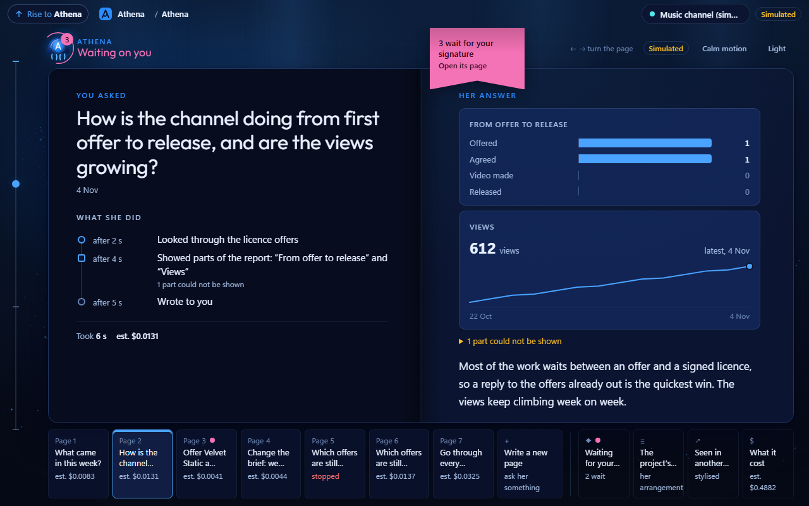

*Screenshots show the real app on example data (a small music channel).*

| You are | Go to |
|---|---|
| Watching the demo | [the demo scenario](docs/hackathon/demo-scenario.md) |
| Evaluating in depth | [the features](docs/features/README.md), [the architecture](docs/adr/0002-two-windows-over-one-loopback-daemon.md), [26 decision records](docs/adr/0001-repo-posture.md) |
| Contributing | [AGENTS.md](AGENTS.md) |

## Why it matters

A chatbot answers a question and forgets it. Most of what people actually need done is repetitive
work spread across websites, apps and inboxes: checking, comparing, chasing, replying, filing. Athena
takes that work over. She keeps each line of work in a **project** with its own memory, learns your
tasks from a conversation, writes for you where you'd normally write yourself, and uses whatever
computers you have. You decide; she does.

## What she does

### Automate any task

Tell Athena what you want done, the way you'd tell a person. She asks a few questions and draws the
plan as you talk: the sites and apps involved, the steps, and what you get back. You confirm what's
right. Before anything goes live she shows exactly what she would do, you say yes or no to each step,
and she practises on a safe copy, graded against your own answers. Then the task is yours, ready to
run whenever you need it.

| 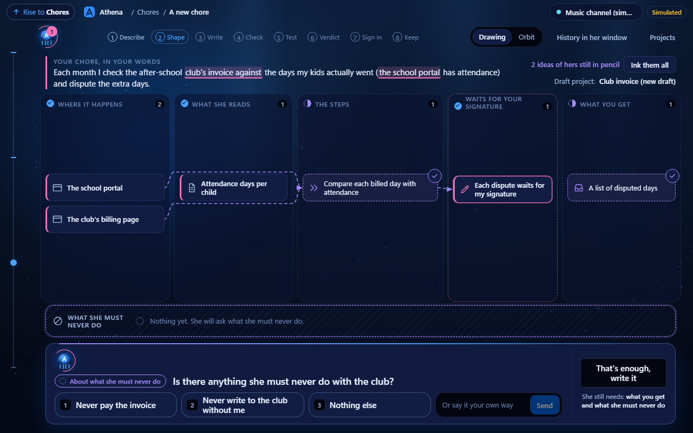 | 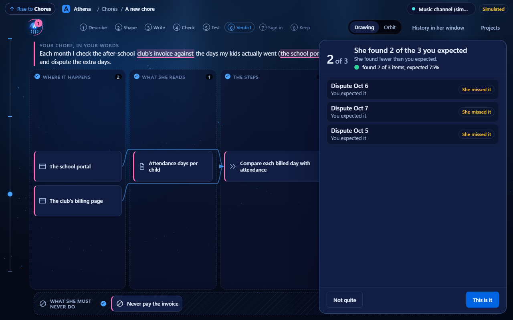 |
|---|---|
| She draws the plan as you talk | The practice run, graded by your own answers |

| 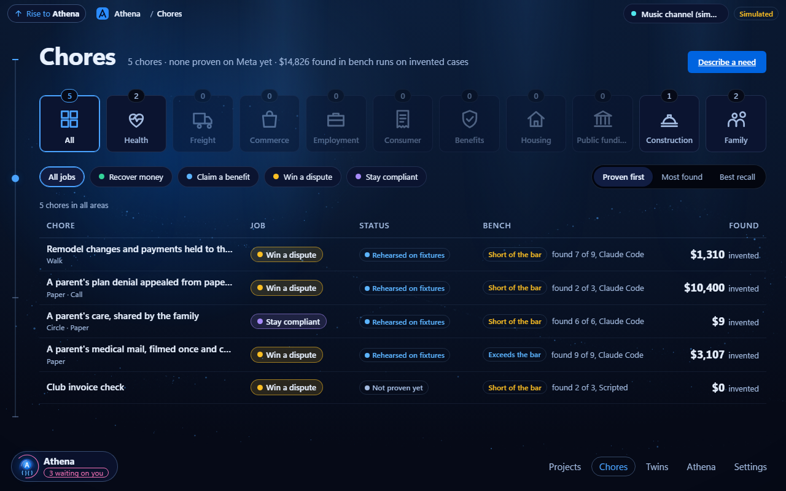 | 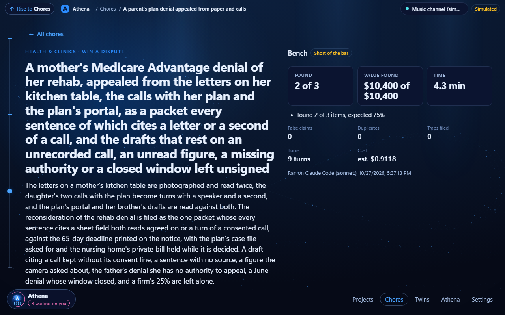 |
|---|---|
| Tasks from any area of life: health, home, money, family | One task and how well it did in practice |

### Keep your work in projects

Each project remembers its own context and keeps it to itself. Athena builds a dashboard for it,
connects the apps it needs, and runs its routine checks in the background within a spending limit you
set. Ask her anything, in her small always-on window or full screen, and every answer shows what she
did, how long it took and what it cost.

| 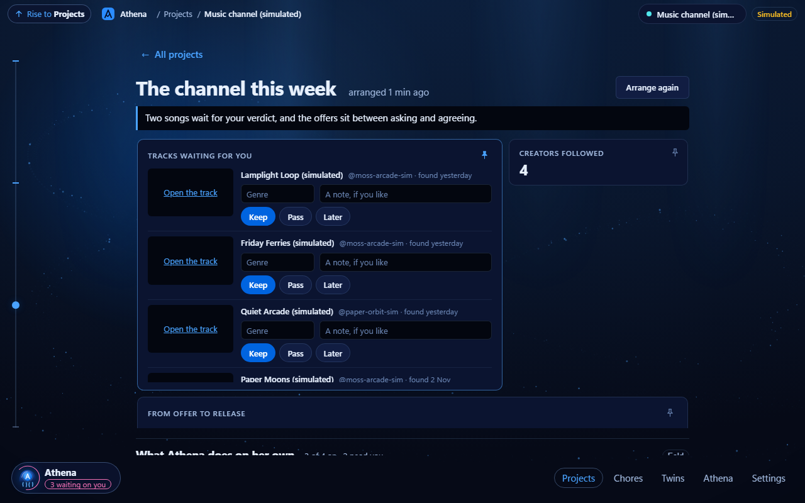 | 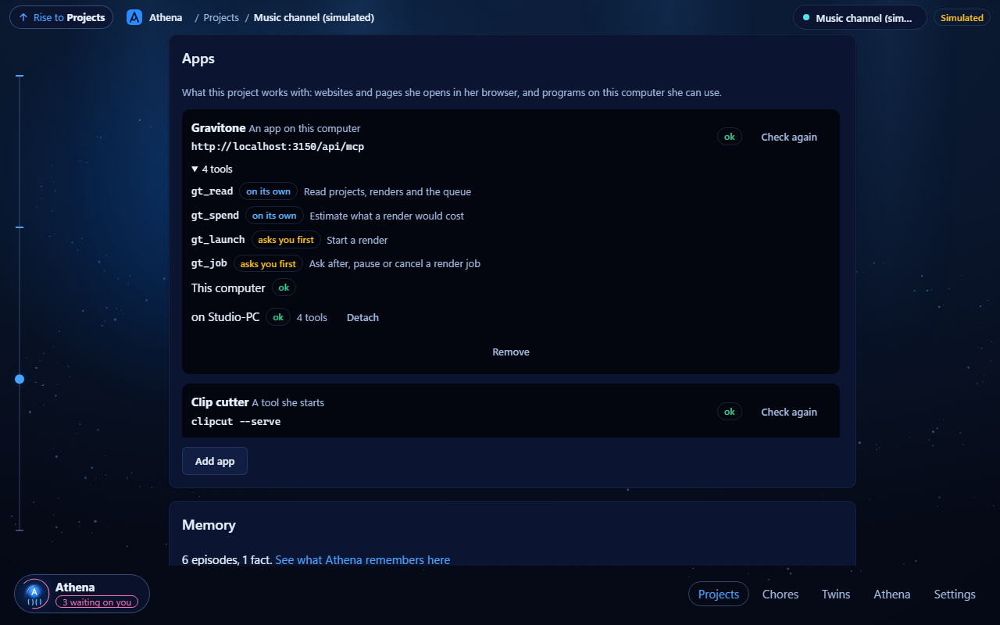 |
|---|---|
| A project dashboard she put together | The apps a project uses, including one on another PC |

| 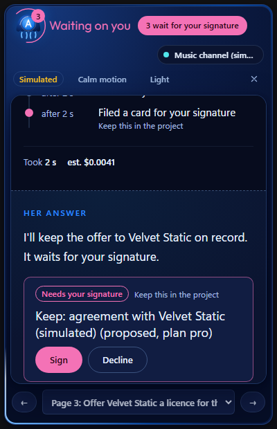 | 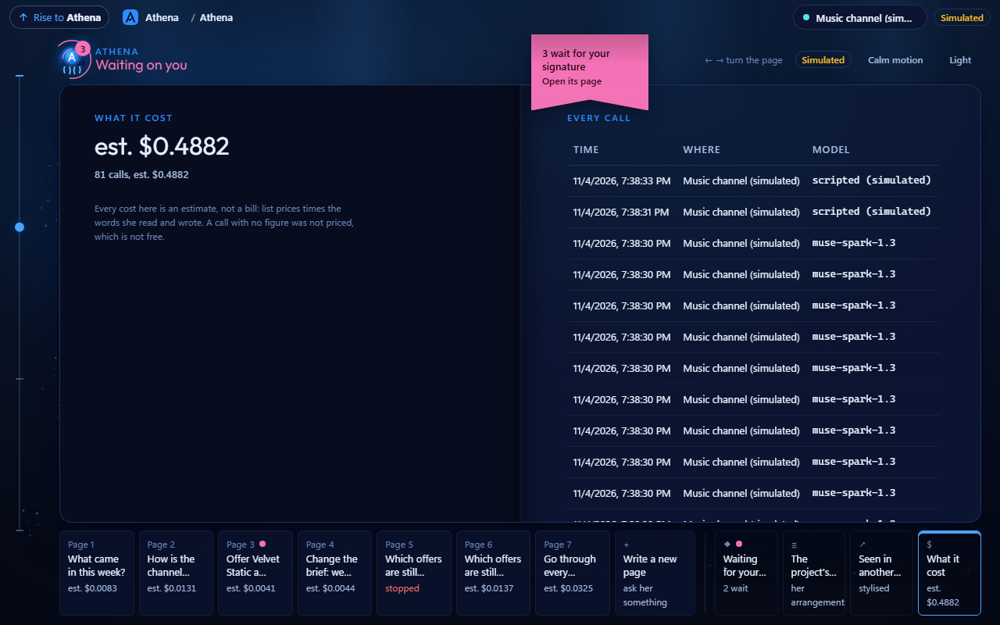 |
|---|---|
| One click to approve what matters | Every cost, on record |

### Let your Twin answer for you

Your Twin learns your voice from the messages you've sent, rehearses with you until it sounds right,
then works toward a goal in each conversation: getting an answer, closing a deal, following up. It
replies on its own when it's sure, and hands the conversation back to you when it isn't, or when money
comes up.

| 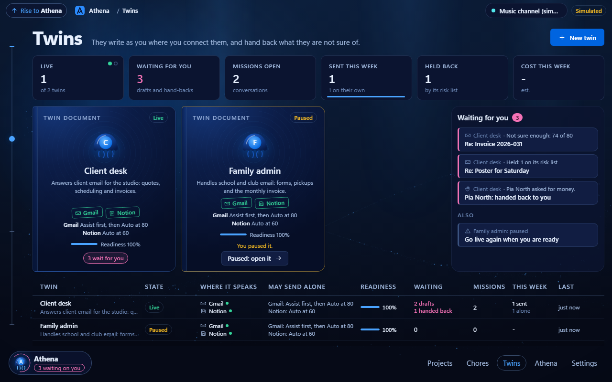 | 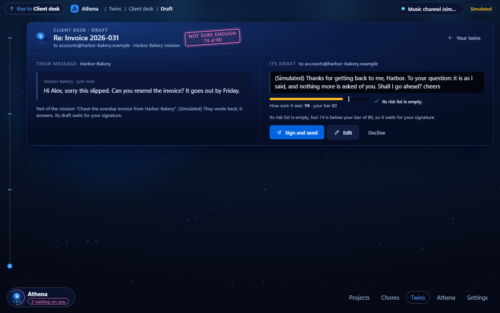 |
|---|---|
| Your Twins and the conversations they handle | A reply it held back for you to decide |

### Use all your computers

Connect another PC or your phone in a few steps. Athena sees each machine and what it can handle, so
one project can send heavy work, like rendering a video, to the stronger computer while you approve
from wherever you are. On your phone you can talk to her and approve what's waiting, in the same look
as your desktop.

| 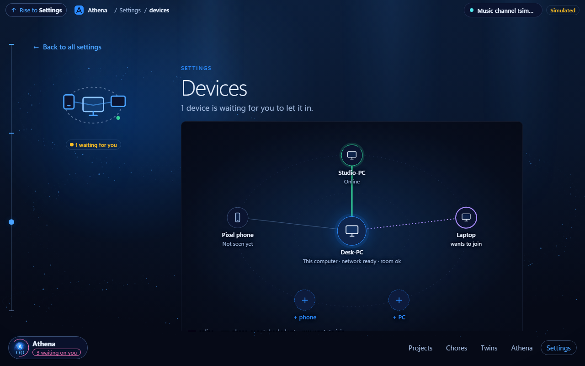 | 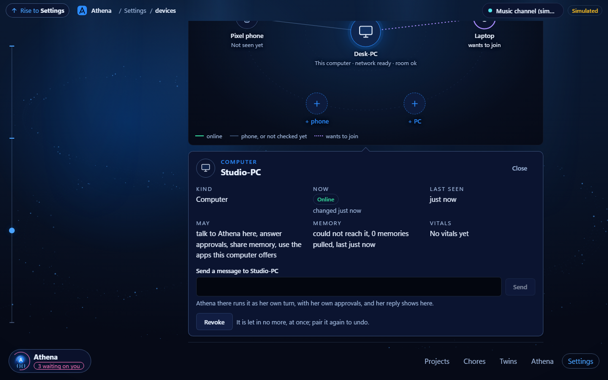 |
|---|---|
| Your connected computers and phone | One computer, and what it's allowed to do |

## Built on Meta's Muse

Muse Spark is the mind behind Athena: it holds the conversation that turns a plain request into a
working task, writes the task, predicts what it will do, and runs the practice that grades it. We
tested Muse against a leading frontier model on ten real setups, graded blind: Muse completed all ten
within our pass mark, and its slowest answer came almost four times sooner (21 s against 79 s;
[details](docs/features/chore-onboarding.md)). Athena can also run on other models, and the rules stay
the same whichever one is thinking. The live Muse runs so far go through Muse Code; the direct Muse API
connection is built and waits for a key ([facts](docs/hackathon/meta-api-facts.md)).

## Under the hood

For developers. A Tauri + React desktop app over a local Python service, with one wire contract kept
in step by tests ([ADR 0002](docs/adr/0002-two-windows-over-one-loopback-daemon.md)). Safety rules live
in code, not in the model: models propose, code decides. Tasks are stored as data and rehearsed
headless against invented sites ([ADR 0005](docs/adr/0005-chores-are-data-rehearsed-on-a-bench.md)).
Every feature ships with its tests and a decision record.

```bash
node scripts/preflight.mjs        # toolchain: node, pnpm, uv, python, cargo
uv sync && pnpm install           # dependencies
pnpm -C apps/desktop app          # build and open Athena
```

Optional: `META_API_KEY` in the environment (or paste it on first launch), or Muse Code on PATH. With
neither she runs in a labelled demo mode.

```bash
uv run ruff check src tests && uv run mypy && uv run pytest -q
pnpm -C apps/desktop typecheck && pnpm -C apps/desktop lint && pnpm -C apps/desktop test
node scripts/check.mjs            # docs gate
```

The README's screenshots are re-taken with `uv run python scripts/readme_shots.py`.

## Not yet done

- The direct Muse API connection measured with a real key.
- Twins on a real mailbox, and two real PCs over a private network (both tested end to end on
  stand-ins today).

Licence: Apache-2.0.
