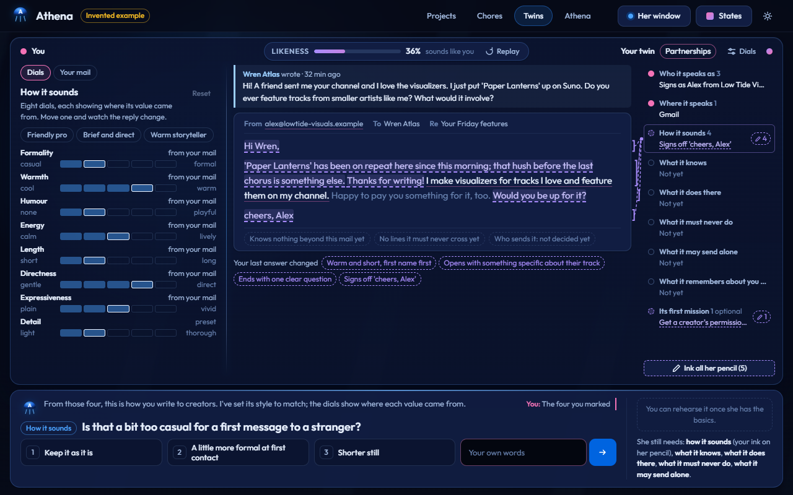
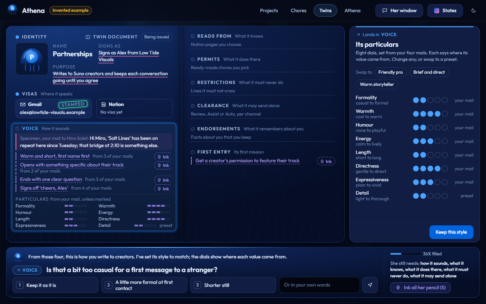
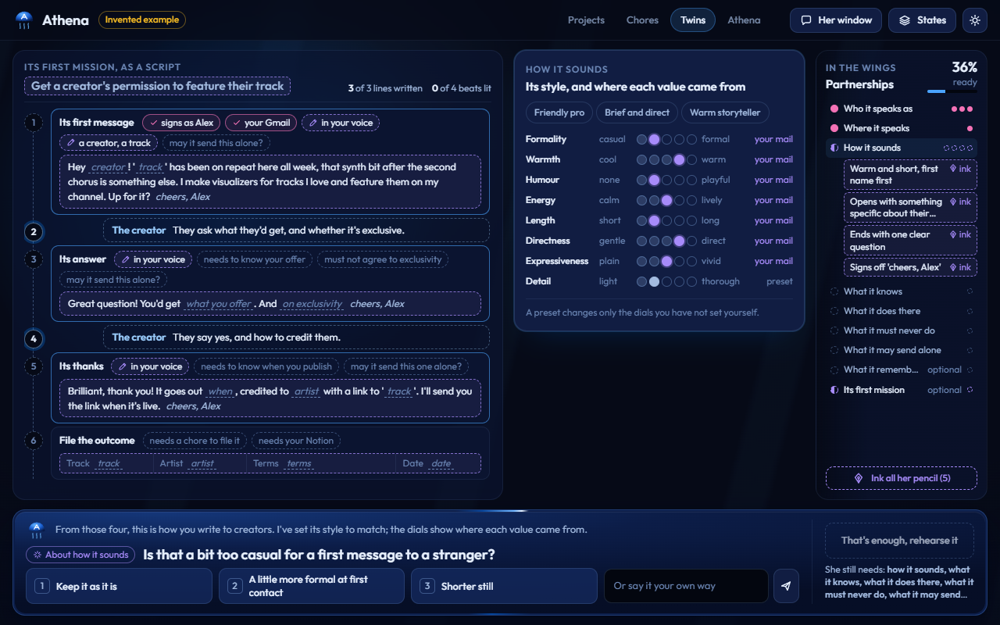

# Twin module - a clone that speaks for you, set up with Athena

Status: **designed; Passport picked** (2026-10-29). Nothing in the app is built yet. Of the three
prototypes (Mirror, Passport, Rehearsal) the owner picked [Passport](#passport---open--notes); the
other two stay as reference. The build plan is at the end.

## Spark

Owner, 2026-10-29:

> start project of creating Twin module, inspired by our implementation [personas], we will need to design ultimate experience to onboard a twin - digital clone serving for communication, setup channels via app's connectors (currently google,notion only) with goal Athena can help onboard the twin, and use twin to handle custom tasks by user to resolve conversation. UI will need one-page experience: 1. Overview page with list of twins via Ledger and stats components 2. Onboarding experience with dynamic UI and bottom chat panel to communicate with athena during the setup. ... Design and prototype three variants covering both pages, look into historical prototypes for onboarding v2, where all variants achieved high quality of designs and creative solution which we will need to get inspired from. Personas on the other hand will have package of features we can pick from to create optimal experience

## What it builds on (scouted 2026-10-29)

**This repository.**
- Routes are a union in `apps/desktop/src/main/route.ts`; a Twins page is two members, a nav link and one content line. The stage shows how a page takes the whole window (`App.tsx` early return).
- The ledger is `LedgerRow` (`contracts.py` / `contract.ts`, parity-tested), served at `GET /ledger` and drawn as the Costs table on the Athena page (`m-totals` line, `m-table`, badge tones). It has no space filter. There is **no stat component** anywhere in the desktop.
- A bottom chat panel already exists: the Drawing view's `Note` pins her line, the question, suggestions, the composer, thinking/slow/failed and the "enough" exit across the bottom, all from store-free `stage/parts`. `StillNeeds` and `EnoughButton` are typed to the chore's coverage and would need a generic coverage.
- There are **no connectors, no twin and no delegated mail**. The gate files a card and resolves it exactly once; `CardView` has no editable text.
- [Business channel](../business-channel/README.md) planned Twins as a tone profile per channel plus your edits as examples, every send a card, and reaching the mailbox through her browser rather than a connector.

**athena-portable** (the earlier sibling):
- Connectors are data: `gmail.json` (sign in with Google through a loopback flow with PKCE, the person's own Google client; read and send) and `notion.json` (a pasted integration key; search, read, append, create). "Google" is Gmail only.
- One vault seals every credential (DPAPI or the keyring), probes it before keeping it, keeps writes off by default and refuses any write outside an allow-list.
- The Connect screen shows idle, waiting for the browser, failed, needs sign-in again and connected states.

**personas** (the feature menu). Built and mounted there:
- create a twin;
- a planned interview whose proposals the person accepts, edits or dismisses;
- tone per channel, learned only from the person's own samples;
- eight style dials with presets and where each value came from;
- readiness derived from data (identity, tone, brain, channels, memories);
- a memory review queue with reasons;
- a reply outbox with steer chips, where approving only logs;
- roster cards and channel health (quiet, stale, never).

**Absent in personas**, which is exactly what this module adds:
- a working channel connect;
- reading incoming messages;
- real sending;
- autonomy levels;
- goal-directed conversations;
- learning from the person's edits.

**The bar.** The [onboarding v2](../chore-onboarding-v2/README.md) contest winners, Pencil & Ink and Orbit, set it, along with the other four entries:
- the one thing the person must do now dominates the screen;
- her guesses are drawn in pencil and the person's words in ink;
- nothing already placed moves;
- no page scroll at 1280x800, and the layout holds at 1024x700.

**Standard read** (registry `speed-to-lead-and-assisted-reply` / `risks-gate-not-confidence`):
- Each channel has three autonomy levels, with Assist as the default.
- A draft sends alone only when all four hold: the channel is enabled, the channel is on Auto, the draft is at least as sure as the channel's bar, and its risk list is empty.
- One gate function decides this, and a disabled channel never sends.

## Design decisions

Wave 1:
- **Channels: port athena-portable's Gmail and Notion connectors and vault into athena-muse.** Twin channels are connected accounts. This changes the business-channel rule "no per-service connectors" for Twins, and needs its own ADR at build time. Rejected: reaching mail through her browser; a connector now with the browser later; building the Twin in athena-portable.
- **Notion: knowledge, outcomes, a channel and a task inbox, all as preset chores.** The owner's words: "Notion tasks should be custom chore - Outcome, Channel for testing, Inbox all possible. But not as hardcoded Athena feature, rather preset chore. User can select in the future more tools to integrate as we will add." A twin's tool uses are chores ([ADR 0005](../../adr/0005-chores-are-data-rehearsed-on-a-bench.md)) picked from a catalogue that grows.
- **Tasks: mission first, standing rules next.**
  - A mission is a goal on one conversation. The twin drafts each turn toward it and reports when the mission is resolved.
  - When it is unsure, it hands the conversation back to the person.
  - Rejected: one-off draft requests only.
- **From personas, all four:**
  - voice only from the person's own samples;
  - an interview with her proposals in pencil;
  - style dials with presets;
  - memory review.

Wave 2:
- **Autonomy: Review, Assist and Auto all live in v1.** The owner chose this over keeping Auto locked. Held drafts show their risk list and how sure the twin was against the bar.
- **Setup ends in a dress rehearsal** on a Notion practice page, with Athena playing the other side. The person marks each draft "that's me" or "not me", and their edits teach the twin; then it goes live. Rejected: going live on a real thread first; treating readiness at 100% as the finish.
- **Three concepts:** Mirror, Passport and Rehearsal. Rejected: Constellation (Orbit lineage).
- **Example:** three twins on the overview (Client desk live, Family admin paused, Partnerships being set up); setup plays Partnerships, the creator outreach from the business channel.

Decided as convention:
- **Ledger and stats.** "Ledger" is the app's row table: rows, badges and a totals line. "Stats" is a stat strip in which an unmeasured value shows "-", never 0. Each row is a twin.
- **One page.** Each prototype's `index.html` holds both pages at `#overview` and `#setup`.
- **Setup order:**
  1. Who it speaks as.
  2. Gmail sign-in.
  3. Voice from your sent mail.
  4. Style dials.
  5. Notion key and the pages it may know.
  6. Chore presets.
  7. What it must never do.
  8. Autonomy per channel.
  9. Memory.
  10. The first mission, then the dress rehearsal, then go live.
- **Words.** Plain words only. Never "token", "connector", "OAuth", "API", "prompt" or "node".

## The prototypes

Open each `index.html` from disk. All three play one invented example, generated from
[`prototypes/shared/src/twin.src.mjs`](prototypes/shared/src/twin.src.mjs) by `node src/build.mjs`.
Its schema is [`prototypes/shared/SCHEMA.md`](prototypes/shared/SCHEMA.md) and the states every
variant shows are in [`prototypes/shared/states.md`](prototypes/shared/states.md).

All three play the same invented example:
- overview stats: 1 live twin, 3 waiting for you, 2 missions open, 23 sent this week (14 on its own), 3 held by the risk list, est. $1.90;
- 12 setup frames, ready to rehearse from frame 9;
- the Lumen Vale rehearsal with a held reply (77 against a bar of 80, one risk) and a reply sent on its own (91, no risks).

Every variant exposes `window.TwinProto` (`states`, `go(id)`) and a States menu. A Playwright pass drove every state at 1280x800 and 1024x700 (2026-10-29, run by the Director). It found no page scroll, no text under 12 px, no banned word and no console error: Mirror 92 checks, Passport 88, Rehearsal 86. Each variant also played its whole staged path by clicks and keys with no errors. `shots/` keeps four screenshots at 1280x800 and `report.json`.

### Mirror - [open](prototypes/mirror/index.html) · [notes](prototypes/mirror/NOTES.md)

**Idea.** The twin's draft reply to a real-looking creator message (Wren Atlas, variant data) sits in a mirror beside your own sent mail.

**How it reads.** Each answer rewrites the draft:
- stock phrasing is grey;
- her proposals are dashed violet pencil, with the words your last answer changed listed under the draft;
- settled words are ink.

A likeness bar climbs from 14% to 100%. The twin's parts hang as marginalia, with leaders drawn to the words they shape.

**Overview.** The waiting drafts and the hand-back sit as small mirrors, their message beside its draft.

**Strongest at** making "it sounds like you" visible.

**Weakest at** the rehearsal screen, which leaves empty columns.

### Passport - [open](prototypes/passport/index.html) · [notes](prototypes/passport/NOTES.md)

**Idea.** The twin is a document being issued, with these sections:
- identity, with a monogram in her seal's language;
- visas that stamp themselves on sign-in;
- voice: a specimen of your mail plus eight particulars;
- permits (preset chores, with "coming" tools as blanks);
- restrictions;
- clearance per channel;
- endorsements (memory);
- the first entry (the mission).

**How it reads.** The section she is asking about is lit with "Your answer lands here", and a working slip beside the spread holds the panel. Go live presses a seal into it.

**Overview.** A wallet of closed documents over the ledger.

**Strongest at** a twin you can read at a glance, and the most distinctive overview.

**Weakest at** density: at 1024x700 a few long items wrap or truncate.

### Rehearsal - [open](prototypes/rehearsal/index.html) · [notes](prototypes/rehearsal/NOTES.md)

**Idea.** Mission first. From frame 0 the Lumen Vale conversation shows as six unwritten beats, each naming what it needs ("needs your voice", "must not agree to exclusivity", "may it send this alone?").

**How it reads.** Answers light the beats that depend on them, and one answer about voice writes three of the twin's lines in pencil. The twin's parts gather in the wings with a readiness meter. The dress rehearsal plays the same script for real.

**Overview.** Open missions show as scripts in progress (beat 4 of 5, handed back).

**Strongest at** tying setup to the job the twin will actually do.

**Weakest at** fit: at 1024x700 the last beat sits under a fade on two frames, inside a column that scrolls on its own.

### What carries over whichever is picked

- Athena's bottom panel is the same in all three, and maps onto `stage/parts`. It holds:
  - her line;
  - one question with a chip naming its place;
  - three suggestions on keys 1-3;
  - your own words;
  - "Ink all her pencil";
  - what she still needs;
  - "That's enough, rehearse it".
- A held draft always shows how sure it was against the bar, plus its risk list, with sign, edit and decline.
- The overview is a stat strip, then the ledger, with a "Waiting for you" band (all three builders found that the space under the ledger wanted it).

## Build plan (Passport, agreed 2026-10-29)

Wave 4 settled the architecture:
- **Replies:** the daemon polls Gmail threads that have an open mission while it runs; nothing runs while it is closed.
- **Sends:** v1 sends real email to any recipient. The send rule and the risk list are the only guard.
- **Setup turn:** the onboarding-v2 drafts machinery is generalised to carry a twin rubric, not copied.
- **Connectors:** athena-portable's vault, seal, Google sign-in, Gmail and Notion are ported; its MCP client is not.

Repo law applies throughout: the contract comes first, one commit per feature, and ADRs land in the commit they decide.

### Decisions to record

- **ADR 0008, Twins speak through connected accounts.**
  - The Gmail and Notion connectors and the vault are ported from athena-portable.
  - Credentials live under the daemon's data dir, sealed by DPAPI or the keyring, and are probed before they are kept.
  - Twin Gmail sends may go to any recipient; this replaces the vault's "an empty allow-list refuses every write" rule for twins only.
  - It amends the business-channel rule "no per-service connectors" for Twins.
- **ADR 0009, the send rule.**
  - `decide(channel, draft) -> Decision` is one pure function. A draft is sent alone only when all of these hold:
    - the channel is connected and the twin is live;
    - the level is `auto` (or the `split` level for this kind of message is `auto`);
    - `confidence >= bar`;
    - `risks` is empty.
  - Everything else waits, with a reason. A paused twin or channel never sends.
  - The interactive path, the poller and the rehearsal call the same function.
  - A waiting draft is a signature card whose text the person may edit. An alone send writes a ledger row and a mission turn.
- **ADR 0010, one shaping conversation, two rubrics.**
  - The drafts machinery carries a rubric object: places, required coverage, meanings and kinds.
  - Chore drafts and twin setup are two rubrics on the same code.

### Wire contract (WP0, committed by the Director with compilable stubs)

**WP0 done (2026-10-29):** ADRs [0008](../../adr/0008-twins-speak-through-connected-accounts.md), [0009](../../adr/0009-one-send-rule-for-every-twin-draft.md) and [0010](../../adr/0010-one-shaping-conversation-two-rubrics.md), the contract on both sides with its parity test, and every twin and connector route mounted as a 501 stub naming its package.

`contracts.py` and `contract.ts` change together, and `tests/test_contract_parity.py` gains the new enums, caps and routes.

**Enums.**

| enum | values |
|---|---|
| `Place` | `who` `channels` `voice` `knowledge` `chores` `never` `autonomy` `memory` `mission` |
| `ChannelKind` | `gmail` `notion` |
| `Autonomy` | `review` `assist` `auto` |
| `TwinState` | `setting_up` `live` `paused` |
| `ChannelStatus` | `connected` `needs_sign_in` `disconnected` |
| `ChannelHealth` | `active` `quiet` `stale` |
| `MissionState` | `open` `resolved` `handed_back` |
| `Decision` | `sent_alone` `waits` |
| `WaitReason` | `review` `assist` `first_message` `below_bar` `risk` `paused` |
| `Mark` | `me` `edited` `not_me` |

`Surface` gains `twin`. `ActionName` gains `twin_send` (gated: one Gmail message, in-thread when replying) and `twin_note` (gated: one Notion append or create, used by preset chores).

**Types.** The field names are the ones in the prototypes' [`shared/SCHEMA.md`](prototypes/shared/SCHEMA.md). The daemon owns every derived number: `readiness`, `stats`, `coverage` and `open_missions`.
- `TwinSummary`, `TwinDetail`, `TwinChannel` (`kind`, `account`, `status`, `autonomy`, `bar`, `split`, `scope`, `health`, `last_at`).
- `Piece` (`id`, `place`, `label`, `detail`, `origin`, `confirmed`, `evidence`), `StyleDial`, `Sample`, `MemoryFact`, `ChorePreset`.
- `Mission` (with `beats: {label, done}[]` for the nested script) and `MissionTurn`.
- `TwinDraft` (`id`, `mission`, `channel`, `to`, `subject`, `text`, `confidence`, `risks`, `decision`, `reason`, `card_id`).
- `TwinStats` and `TwinPage {twins, stats}`.

**Absent values.** These follow the contract's own rule: an absent value is an omitted key, never `null`. An unmeasured figure is omitted and renders "-", never 0. A name that already exists on the wire (`Mark`) is prefixed for twins (`TwinMark`, `SendDecision`).

**Routes.**

| purpose | routes |
|---|---|
| Overview | `GET /twins` -> `TwinPage` |
| Create | `POST /twins {space_id}` -> `TwinDetail` |
| One twin | `GET /twins/{id}` -> `TwinDetail` |
| Setup conversation | `POST /twins/{id}/say {text?, choice?}` (NDJSON `TurnEvent` plus `sketch`/`ask`/`coverage`, as drafts); `POST /twins/{id}/confirm {pieces}`; `POST /twins/{id}/drop {piece}` |
| Setup panels | `POST /twins/{id}/samples {ids}`; `/dials {dials}`; `/pages {ids}`; `/chores {ids}`; `/autonomy {channel, autonomy, bar, split?}`; `/memory {id, keep, reason?}` |
| Rehearsal | `POST /twins/{id}/rehearse {goal}` (NDJSON turns); `POST /twins/{id}/rehearse/mark {turn, mark, edited_text?}` |
| Going live and pausing | `POST /twins/{id}/golive`; `POST /twins/{id}/pause` |
| Missions | `POST /twins/{id}/missions {thread, goal}` -> `Mission`; `GET /twins/{id}/missions/{mid}` |
| Connectors | `GET /connectors`; `POST /connectors/{kind}/connect {client_id, client_secret}` or `{key}`; `GET /connectors/{kind}/flow`; `POST /connectors/{kind}/disconnect`; `POST /connectors/{kind}/probe` |
| Signature decisions | `POST /decisions/{id} {verdict, edited?: {text}}`. The executor runs off the event loop, and a failed executor returns the card to `waiting` with a problem line. |

### Work packages

Packages run in order where they share files, and in parallel otherwise.

- **WP1, generalise the drafts machinery.**
  - Scope: `drafts/rubric.py`, `drafts/sketch.py`, `drafts/shape.py`, `turn.py`, `engine/scripted.py`, `stage/select.ts`, `stage/parts/Ask.tsx`.
  - A `Rubric`, a `Design` protocol and the surface taken from the design; `StillNeeds`/`EnoughButton` work on a generic coverage.
  - Acceptance: every existing drafts and stage test passes unchanged in meaning, and a toy second rubric runs a scripted turn.
- **WP2, port the connectors.**
  - Scope: `src/athena/connectors/` and `routes_connectors.py`, with ported tests.
  - The MCP client is dropped and its manifest types are stubbed.
  - New: `read_thread` and `send_mail` with `thread_id` / `In-Reply-To`.
  - The vault root becomes the data dir.
  - Setup shows the "your own Google client" step in plain words.
- **WP3, the twin store and setup.**
  - Scope: `src/athena/twins/` (store, the twin rubric, setup routes, samples, dials, pages, chore presets as playbook data, memory, rehearsal on a Notion practice page with Athena playing the other side) and `store.py` tables.
  - The erase cascade covers the new tables.
  - The scripted engine plays the setup with no key.
  - Depends on WP1 and WP2.
- **WP4, missions, the send rule and the poller.**
  - Scope: `twins/missions.py`, `twins/decide.py`, a Starlette lifespan poller (off when `ATHENA_TWIN_POLL=0` and in tests), and the `gate.py` edited args with off-loop execution.
  - `turn.execute` gains `twin_send` and `twin_note`, and CardView's text becomes editable.
  - Depends on WP2 and WP3.
- **WP5, the Passport page.** Built in parallel with WP2-WP4, on a generated fixture.
  - Scope: `apps/desktop/src/main/twins/` with the `twins`, `twin/<id>`, `twin/<id>/mission/<mid>`, `twin/<id>/draft/<did>` and `twin/<id>/voice` routes.
  - `StatStrip` and `Ledger` move to `src/ui/`, and the Costs table becomes the second caller.
  - The setup spread and slip go here, with Athena's bottom panel built from `stage/parts`.
  - The fixture is generated through the daemon's twin rules once WP3 lands; until then it is generated from the prototype's source, in wire shape, and labelled.
  - The borrowed ideas are nested, per the owner's rule:
    - a "sounds like" line on the voice section opens the voice page;
    - beat dots on a mission row open the mission script;
    - a two-line waiting card opens the draft beside the message it answers.
  - Fidelity is checked against `prototypes/passport` the way the onboarding-v2 port was (style contract, role map, 0 deviations).
- **WP6, the live seam.**
  - A Playwright script drives the built app against a real daemon: setup on the scripted engine and on Claude Code, then the rehearsal on a Notion practice page.
  - One real Gmail send to the owner's own address, run only with the owner present.
  - The docs and the README status are updated.

## Known limits (v1)

- One account per service per daemon: connector routes are keyed by kind, so twins share one Gmail and one Notion account (ADR 0008). The overview example's second Gmail address (Family admin) is illustrative.

## Open (owner)

- Picked 2026-10-29: **Passport** ("Passport is the winner").
- Wave 3, after the pick:
  - The working slip stays beside the spread.
  - The rehearsal keeps its trip page.
  - Three ideas are borrowed from the other prototypes: Mirror's live draft preview, Rehearsal's mission beats and Mirror's waiting cards. The owner's rule for them: "as nested content, in main content represented by stat or smaller component to fit, on click to have standalone page design".
  - Build order: the contract and stubs come first, then the Passport page on a generated fixture is built in parallel with the backend.
